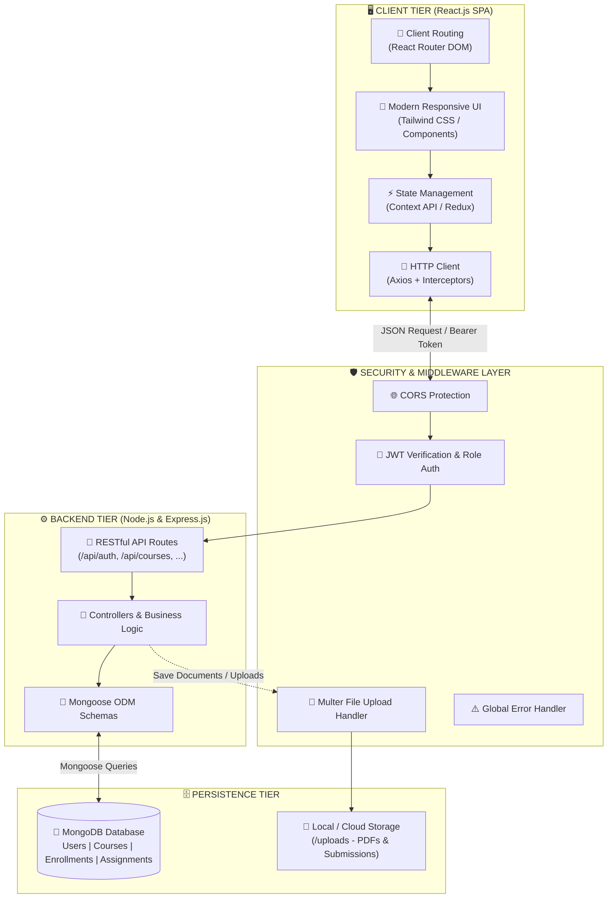
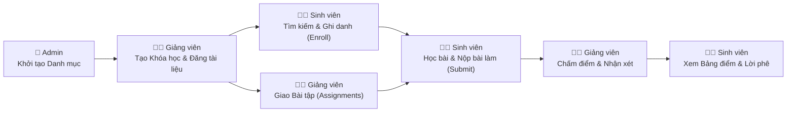
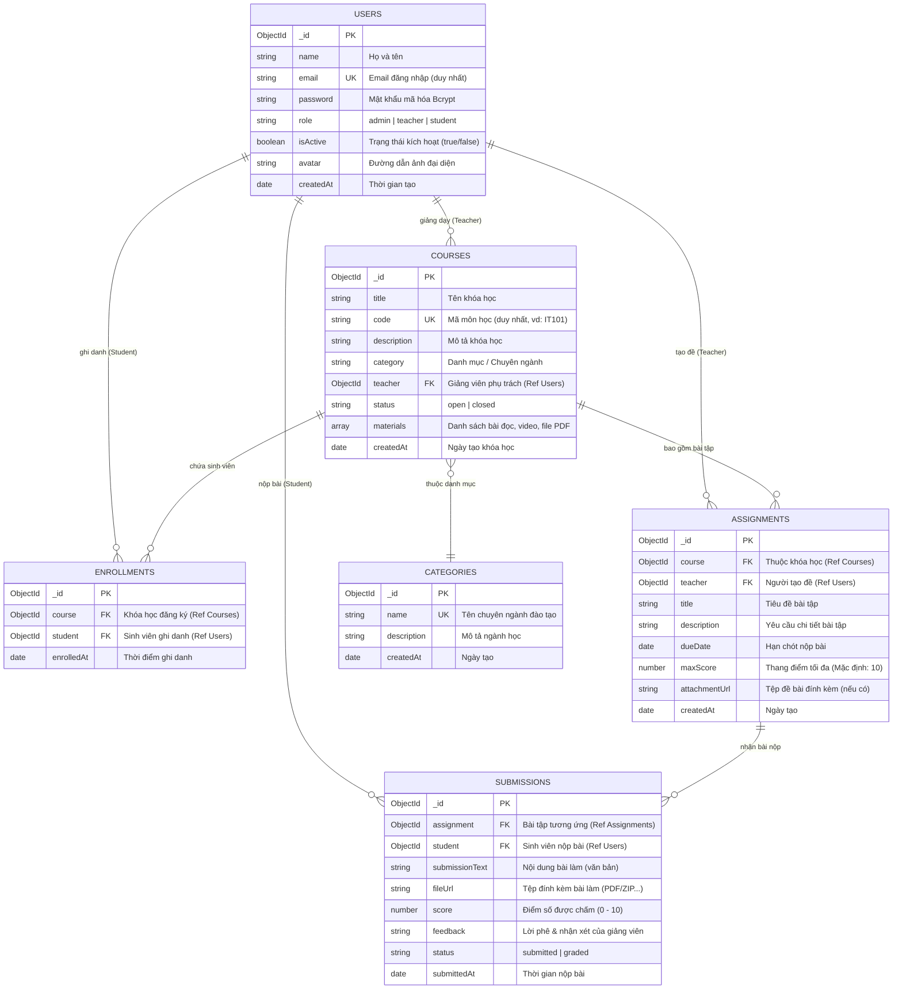

# 🎓 ĐỀ TIỂU LUẬN CUỐI KỲ: XÂY DỰNG HỆ THỐNG LỚP HỌC TRỰC TUYẾN
## 💻 MÔN HỌC: LẬP TRÌNH WEB NÂNG CAO (MERN STACK)

<div align="center">


---

### 📋 THÔNG TIN TỔNG QUAN HỌC PHẦN

| Thông số | Nội dung chi tiết |
| :--- | :--- |
| **Tên học phần:** | Lập trình Web / Ứng dụng Web nâng cao |
| **Công nghệ bắt buộc:** | **MERN Stack** (MongoDB, Express.js, React.js, Node.js) |
| **Hình thức thực hiện:** | Cá nhân hoặc Nhóm (Tối đa 2 - 3 sinh viên/nhóm) |
| **Thời gian thực hiện:** | 04 - 06 tuần |
| **Hình thức đánh giá:** | Báo cáo đồ án (PDF), Mã nguồn (GitHub) & Vấn đáp trực tiếp |

---

</div>

> [!IMPORTANT]
> **MỤC TIÊU HỌC PHẦN (COURSE OBJECTIVES):**  
> Đề tiểu luận giúp sinh viên vận dụng kiến trúc Fullstack hiện đại để thiết kế và hiện thực hóa một hệ sinh thái phần mềm hoàn chỉnh: từ tổ chức cơ sở dữ liệu phi quan hệ (NoSQL Document Store), xây dựng cổng giao tiếp API bảo mật chuẩn RESTful, đến phát triển giao diện người dùng tương tác thời gian thực (Single Page Application - SPA) tuân thủ các quy chuẩn công nghiệp.

---

## 📑 MỤC LỤC CHI TIẾT
1. [Chủ đề dự án & Bối cảnh phát triển](#1-chủ-đề-dự-án--bối-cảnh-phát-triển)
2. [Sơ đồ kiến trúc & Luồng nghiệp vụ hệ thống](#2-sơ-đồ-kiến-trúc--luồng-nghiệp-vụ-hệ-thống)
3. [Mô tả chi tiết yêu cầu tính năng cốt lõi (Core Features)](#3-mô-tả-chi-tiết-yêu-cầu-tính-năng-cốt-lõi-core-features)
4. [Yêu cầu kỹ thuật chuyên sâu (Technical Specifications)](#4-yêu-cầu-kỹ-thuật-chuyên-sâu-technical-specifications)
5. [Thiết kế cơ sở dữ liệu lược đồ (Database Schema & ERD)](#5-thiết-kế-cơ-sở-dữ-liệu-lược-đồ-database-schema--erd)
6. [Yêu cầu nộp bài & Quy chuẩn đóng gói (Deliverables)](#6-yêu-cầu-nộp-bài--quy-chuẩn-đóng-gói-deliverables)
7. [Thang điểm đánh giá chi tiết (Grading Rubric - Thang điểm 10)](#7-thang-điểm-đánh-giá-chi-tiết-grading-rubric---thang-điểm-10)
8. [Checklist kiểm tra trước khi nộp bài](#8-checklist-kiểm-tra-trước-khi-nộp-bài)

---

## 1. CHỦ ĐỀ DỰ ÁN & BỐI CẢNH PHÁT TRIỂN

- **Nguồn cảm hứng:** Tuyển chọn từ danh mục *40 Best Web App Ideas for Students Project* (theo khảo cứu từ *iTechnolabs*).
- **Tên đề tài chính thức:** **XÂY DỰNG HỆ THỐNG LỚP HỌC TRỰC TUYẾN (ONLINE CLASSROOM)**
- **Khái niệm hệ thống:**  
  Nền tảng lớp học ảo (Online Classroom LMS) là không gian số hóa giúp thu hẹp khoảng cách địa lý và thời gian trong giáo dục đại học. Hệ thống cung cấp môi trường giảng dạy tương tác hai chiều:
  - **Giảng viên:** Dễ dàng số hóa tài liệu giảng dạy, tổ chức lớp học, phát hành bài tập và đánh giá năng lực người học qua bảng điểm minh bạch.
  - **Sinh viên:** Chủ động ghi danh môn học, tiếp cận bài giảng đa phương tiện (văn bản, video, tệp PDF đính kèm), nộp bài tập trực tuyến và phản hồi học thuật.
  - **Quản trị viên:** Giám sát vận hành toàn hệ thống, kiểm duyệt tài khoản và duy trì danh mục chương trình đào tạo chuẩn hóa.

---

## 2. SƠ ĐỒ KIẾN TRÚC & LUỒNG NGHIỆP VỤ HỆ THỐNG

### 2.1. Sơ đồ kiến trúc phân tầng (MERN Architecture)



### 2.2. Vòng đời tương tác học tập (Learning Journey Workflow)



---

## 3. MÔ TẢ CHI TIẾT YÊU CẦU TÍNH NĂNG CỐT LÕI (CORE FEATURES)

Hệ thống được thiết kế với cơ chế **Role-Based Access Control (RBAC)** nghiêm ngặt, phân bổ chức năng rõ ràng cho 3 đối tượng người dùng:

### 3.1. Xác thực & Bảo mật (Authentication & Authorization)

> [!NOTE]
> Tất cả các phiên làm việc của người dùng phải được bảo vệ qua cơ chế Stateless Authentication bằng JWT.

- **Đăng ký tài khoản (Register):**
  - Cho phép người dùng đăng ký tài khoản với các trường: Họ tên, Email, Mật khẩu, Số điện thoại và Vai trò ban đầu (`Student` hoặc `Teacher`).
  - Toàn bộ mật khẩu lưu trữ trong CSDL bắt buộc phải được mã hóa một chiều qua thuật toán **Bcrypt** (Salt rounds $\ge 10$).
- **Đăng nhập bảo mật (Login):**
  - Xác thực thông tin Email/Mật khẩu.
  - Kiểm tra trạng thái khóa của tài khoản (`isActive === false` thì từ chối đăng nhập kèm thông báo vi phạm chính sách).
  - Trả về mã **JSON Web Token (JWT)** chứa `id`, `role`, thời hạn sống (Expires in) tối thiểu 7 ngày.
- **Bảo vệ tài nguyên (Protected Routes & RBAC):**
  - Middleware Backend kiểm tra `Bearer <token>` ở HTTP Header `Authorization`.
  - Frontend tự động điều hướng người dùng chưa đăng nhập về trang `/login` và ngăn chặn truy cập trái vai trò (Forbidden `403`).

---

### 3.2. Ma trận tính năng theo vai trò người dùng

| Vai trò | Phân hệ chức năng | Mô tả chi tiết nghiệp vụ | Mức độ ưu tiên |
| :---: | :--- | :--- | :---: |
| <br>**👨‍🏫<br>TEACHER**<br>*(Giảng viên)* | **Quản lý khóa học (CRUD)** | • Tạo mới khóa học (Tên, Mã môn, Mô tả, Ngành học, Ảnh đại diện)<br>• Cập nhật thông tin chi tiết môn học<br>• Đóng/Mở lớp học hoặc Xóa khóa học do chính mình phụ trách | 🟢 **Must-Have** |
| | **Đăng tải học liệu đa phương tiện** | • Đăng bài giảng dạng văn bản đọc lý thuyết (*Text/Article*)<br>• Gắn liên kết Video bài giảng trực tuyến (*YouTube, Drive, Video URL*)<br>• Tải lên tệp tài liệu số định dạng **PDF**, Word, Slide thuyết trình | 🟢 **Must-Have** |
| | **Quản lý bài tập (Assignments)** | • Tạo bài tập mới kèm tiêu đề, hướng dẫn làm bài, tệp đính kèm<br>• Thiết lập thời hạn nộp bài (**Deadline/DueDate**) và thang điểm tối đa | 🟢 **Must-Have** |
| | **Theo dõi lớp học & Chấm điểm** | • Xem danh sách toàn bộ sinh viên đã đăng ký tham gia lớp học<br>• Xem danh sách bài nộp của sinh viên, tải file bài làm<br>• Chấm điểm (0 - 10) và nhập nhận xét/góp ý chi tiết (*Feedback*) | 🟢 **Must-Have** |
| <br>**👨‍🎓<br>STUDENT**<br>*(Sinh viên)* | **Khám phá & Ghi danh (Enroll)** | • Duyệt danh mục các lớp học đang mở với giao diện dạng thẻ (Cards)<br>• Tìm kiếm khóa học theo từ khóa hoặc lọc theo chuyên ngành<br>• Nhấn nút **Ghi danh (Enroll)** để tham gia lớp học ngay lập tức | 🟢 **Must-Have** |
| | **Truy cập bài học & Tải tài liệu** | • Xem lộ trình các bài giảng trong môn học đã tham gia<br>• Mở xem video bài giảng trực tiếp trên hệ thống<br>• Tải về máy các tệp tài liệu PDF và giáo trình do giảng viên cung cấp | 🟢 **Must-Have** |
| | **Nộp bài tập (Submission)** | • Xem yêu cầu đề bài, thời hạn nộp bài còn lại<br>• Nộp bài làm thông qua nhập nội dung văn bản (*Text*) hoặc đính kèm tệp tin (*File Upload: PDF, ZIP, DOCX*)<br>• Cho phép chỉnh sửa/nộp lại bài làm trước khi hết hạn | 🟢 **Must-Have** |
| | **Theo dõi kết quả & Bảng điểm** | • Xem trạng thái bài tập: *Đã nộp / Trễ hạn / Đã chấm điểm*<br>• Xem điểm số đạt được và đọc nhận xét đánh giá từ giảng viên | 🟢 **Must-Have** |
| <br>**👑<br>ADMIN**<br>*(Quản trị)* | **Quản lý người dùng (Users)** | • Xem danh sách toàn bộ người dùng trong hệ thống (phân trang, lọc vai trò)<br>• Thực hiện **Khóa tài khoản (Lock)** hoặc **Mở khóa (Unlock)** đối với người dùng<br>• Thay đổi vai trò người dùng (Chuyển đổi giữa Sinh viên, Giảng viên, Admin) | 🟢 **Must-Have** |
| | **Quản lý danh mục (Categories)** | • Quản lý các chuyên ngành đào tạo (Công nghệ thông tin, Ngoại ngữ, Kinh tế...)<br>• Thêm, sửa, xóa danh mục nhằm phân loại khóa học khoa học | 🟢 **Must-Have** |
| | **Báo cáo thống kê (Dashboard)** | • Xem các chỉ số trực quan: Tổng số User, Giảng viên, Sinh viên, Khóa học đang mở, Tổng lượt ghi danh và bài nộp | 🟡 **Should-Have** |

---

## 4. YÊU CẦU KỸ THUẬT CHUYÊN SÂU (TECHNICAL SPECIFICATIONS)

Dự án phải tuân thủ nghiêm ngặt chuẩn kiến trúc công nghệ **MERN Stack**:

```text
┌─────────────────────────────────────────────────────────────────────────────┐
│                            KIẾN TRÚC MERN STACK                             │
├─────────────────┬───────────────────────────────────────────────────────────┤
│ Frontend        │ React.js 18+ (Functional Components, Custom Hooks)         │
│ State & Router  │ Context API / Redux Toolkit, React Router DOM v6/v7       │
│ UI / Styling    │ Tailwind CSS, Bootstrap 5 hoặc Material UI (Responsive)   │
│ Backend Runtime │ Node.js (LTS v18.x trở lên)                              │
│ Web Framework   │ Express.js (RESTful Architecture, Middlewares)            │
│ Security & Auth │ JSON Web Token (JWT), Bcrypt.js, CORS, Helmet             │
│ File Uploads    │ Multer (Quản lý lưu trữ tệp tin an toàn)                  │
│ Database & ODM  │ MongoDB (v6.0+) & Mongoose ODM (Schemas, Validators)       │
└─────────────────┴───────────────────────────────────────────────────────────┘
```

### 4.1. Tầng Giao diện (Frontend - React.js)
1. **Mô hình lập trình:** Bắt buộc 100% sử dụng **Functional Components** kết hợp linh hoạt các **React Hooks** chuẩn (`useState`, `useEffect`, `useContext`, `useMemo`, `useCallback`) hoặc Custom Hooks tự định nghĩa.
2. **Quản lý trạng thái (State Management):** Sử dụng `React Context API` hoặc `Redux Toolkit` để quản lý phiên đăng nhập (`AuthContext`), trạng thái người dùng hiện tại và thông báo toàn cục.
3. **Giao diện & Tương thích thiết bị (Responsive Design):** 
   - Ứng dụng phải hiển thị chuẩn mực trên Desktop, Tablet và Mobile.
   - Sử dụng thư viện UI hiện đại: Tailwind CSS, Material UI hoặc Bootstrap.
   - Có trạng thái trực quan: Loading Skeleton / Spinners, Empty States khi chưa có dữ liệu và Toast Notifications khi thao tác thành công hoặc gặp lỗi.

### 4.2. Tầng Máy chủ & Dịch vụ (Backend - Node.js & Express.js)
1. **Kiến trúc RESTful API chuẩn mực:**
   - Sử dụng đúng các HTTP Verbs chuẩn: `GET` (Truy vấn), `POST` (Tạo mới), `PUT` / `PATCH` (Cập nhật), `DELETE` (Xóa).
   - Mã phản hồi HTTP (Status Codes) chính xác: `200 OK`, `201 Created`, `400 Bad Request`, `401 Unauthorized`, `403 Forbidden`, `404 Not Found`, `500 Internal Server Error`.
2. **Phân tách mã nguồn theo mô hình 3 lớp (Layered MVC):**
   - **Routes:** Tiếp nhận URL và định tuyến yêu cầu.
   - **Controllers:** Chứa toàn bộ nghiệp vụ (Business Logic), validation dữ liệu đầu vào.
   - **Models:** Khai báo lược đồ Mongoose, định nghĩa quan hệ và indexes.
   - **Middlewares:** Tách biệt module xác thực JWT, phân quyền vai trò và bắt lỗi tập trung (`errorMiddleware`).

### 4.3. Tầng Cơ sở dữ liệu (Database - MongoDB & Mongoose)
1. **Thiết kế lược đồ chuẩn hóa (Mongoose ODM):** 
   - Đặt kiểu dữ liệu chặt chẽ (`type`, `required`, `trim`, `unique`, `default`).
   - Sử dụng quan hệ liên kết qua `ObjectId` (`ref: 'User'`, `ref: 'Course'`) và cơ chế nhúng mảng lồng nhau (`embedded subdocuments`) khi cần thiết (ví dụ: mảng `materials` trong Khóa học).
2. **Tối thiểu các Collection bắt buộc:**
   - `Users`: Quản lý danh tính, mật khẩu hash, phân quyền, cờ khóa tài khoản.
   - `Courses`: Quản lý thông tin môn học, mã môn duy nhất, giảng viên phụ trách, học liệu đính kèm.
   - `Enrollments`: Quản lý việc sinh viên đăng ký môn học (thiết lập `compound index` chống trùng lặp).
   - `Assignments`: Quản lý các bài tập được giao, hạn nộp, điểm tối đa.
   - `Submissions` *(Khuyến nghị)*: Quản lý bài nộp của sinh viên, file đính kèm, điểm số và nhận xét.

---

## 5. THIẾT KẾ CƠ SỞ DỮ LIỆU LƯỢC ĐỒ (DATABASE SCHEMA & ERD)



---

## 6. YÊU CẦU NỘP BÀI & QUY CHUẨN ĐÓNG GÓI (DELIVERABLES)

Sinh viên bắt buộc phải nộp đầy đủ **02 thành phần độc lập** để được hội đồng chấm điểm:

```text
┌─────────────────────────────────────────────────────────────────────────────┐
│                        02 THÀNH PHẦN BẮT BUỘC NỘP BÀI                       │
├─────────────────────────────────────────────────────────────────────────────┤
│ 1. TỆP BÁO CÁO TOÀN VĂN (FILE PDF)                                         │
│    └── Trình bày theo đúng cấu trúc học thuật chuẩn, không nộp file .docx   │
├─────────────────────────────────────────────────────────────────────────────┤
│ 2. KHO MÃ NGUỒN HOÀN CHỈNH (LINK GITHUB REPOSITORY)                         │
│    └── Public Repository hoặc mời tài khoản GitHub của Giảng viên           │
└─────────────────────────────────────────────────────────────────────────────┘
```

### 6.1. Quy cách chi tiết của File Báo cáo (Định dạng PDF)

Báo cáo phải được dàn trang chuẩn mực theo thứ tự các chương mục sau:
1. **Trang bìa chính thức:**
   - Tên trường, tên khoa, bộ môn.
   - Tên đề tài: **TIỂU LUẬN CUỐI KỲ: XÂY DỰNG HỆ THỐNG LỚP HỌC TRỰC TUYẾN (ONLINE CLASSROOM)**.
   - Bảng thông tin sinh viên thực hiện (Họ tên, Mã số sinh viên, Lớp học phần).
   - Họ và tên Giảng viên hướng dẫn.
   - Địa điểm, Học kỳ và Năm học thực hiện.
2. **Giới thiệu tổng quan & Phạm vi ứng dụng:** Nêu rõ lý do chọn đề tài, mục tiêu và danh sách các tính năng đã hiện thực hóa.
3. **Thiết kế Cơ sở Dữ liệu:** Bản vẽ lược đồ quan hệ thực thể (**ERD Diagram**) và mô tả chi tiết các Collection/Mongoose Schemas.
4. **Tài liệu đặc tả API (API Documentation):** Bảng thống kê toàn bộ API Endpoints (Method, Path, Role, Body mẫu, Response mẫu).
5. **Hướng dẫn cài đặt & Khởi chạy cục bộ (Installation Guide):** Từng bước chi tiết để chạy được ứng dụng từ đầu (Node commands, MongoDB setup, Seed data).
6. **Bộ ảnh chụp minh chứng màn hình (Screenshots):** Chụp rõ nét từng giao diện chức năng chính của cả 3 vai trò (Admin, Teacher, Student) kèm chú thích cụ thể.
7. **Kết luận & Hướng phát triển:** Tự đánh giá mức độ hoàn thành và hướng nâng cấp tiếp theo.

---

### 6.2. Quy cách kho mã nguồn dự án (GitHub Repository)

- **Cấu trúc Repository mẫu:**
  ```text
  online-classroom/
  ├── client/             # Toàn bộ mã nguồn giao diện React.js
  ├── server/             # Toàn bộ mã nguồn API Node.js & Express.js
  ├── docs/               # Chứa file Báo cáo PDF và tài liệu liên quan
  ├── .gitignore          # File cấu hình loại trừ (BẮT BUỘC)
  └── README.md           # Hướng dẫn tổng quan & khởi chạy nhanh
  ```
- **Yêu cầu đối với file README.md:**
  - Mô tả ngắn gọn về dự án và công nghệ sử dụng.
  - Hướng dẫn cài đặt phụ thuộc (`npm install`) và khởi động cả 2 phía Client và Server (`npm run dev`).
  - Cung cấp danh sách tài khoản dùng thử nghiệm (**Demo Accounts**) tương ứng với 3 vai trò: Admin, Teacher, Student.

---

> [!CAUTION]
> ### ⚠️ LƯU Ý BẢO MẬT VÀ QUY TẮC PHẠM QUY (QUAN TRỌNG)
> 1. **Tuyệt đối KHÔNG ĐƯỢC PUSH thư mục `node_modules/`:** Thư mục này chứa hàng ngàn tệp thư viện nặng, làm nghẽn Git history.
> 2. **Tuyệt đối KHÔNG ĐƯỢC PUSH file chứa biến môi trường bí mật (`.env`):** Chứa chuỗi kết nối MongoDB Atlas, mã khóa bí mật JWT (`JWT_SECRET`). Hãy tạo file mẫu `.env.example` thay thế.
> 3. **Bắt buộc cấu hình tệp `.gitignore` ở cấp độ thư mục gốc:**
>    ```gitignore
>    # Dependencies
>    node_modules/
>    
>    # Environment Variables
>    .env
>    .env.local
>    
>    # Build outputs & uploads
>    dist/
>    build/
>    uploads/*
>    !uploads/.gitkeep
>    ```
> *Mọi bài tập vi phạm để lộ file `.env` hoặc đẩy `node_modules` lên GitHub sẽ bị trừ điểm theo quy định học phần.*

---

## 7. THANG ĐIỂM ĐÁNH GIÁ CHI TIẾT (GRADING RUBRIC - THANG ĐIỂM 10)

| STT | Hạng mục đánh giá | Nội dung kiểm tra chi tiết | Trọng số | Điểm tối đa |
| :---: | :--- | :--- | :---: | :---: |
| **I** | **Bảo mật & Phân quyền (Auth & RBAC)** | • Đăng ký, đăng nhập bảo mật với JWT Token<br>• Mã hóa mật khẩu an toàn bằng Bcrypt<br>• Phân chia và kiểm soát chặt chẽ 3 vai trò (Admin, Teacher, Student) | **15%** | **1.5 điểm** |
| **II** | **Chức năng Giảng viên (Teacher Module)** | • CRUD lớp học thành công<br>• Đăng tải tài liệu (Đọc, Video Link, File PDF đính kèm)<br>• Giao bài tập (hạn nộp, thang điểm)<br>• Quản lý sinh viên & chấm điểm bài tập kèm nhận xét | **25%** | **2.5 điểm** |
| **III** | **Chức năng Sinh viên (Student Module)** | • Xem danh sách lớp học, tìm kiếm, lọc theo ngành và Ghi danh<br>• Truy cập bài học, xem video, tải file tài liệu bài giảng<br>• Nộp bài tập (Upload file hoặc text)<br>• Xem kết quả, điểm số và nhận xét từ giảng viên | **20%** | **2.0 điểm** |
| **IV** | **Chức năng Quản trị (Admin Module)** | • Dashboard thống kê chỉ số toàn hệ thống<br>• Quản lý người dùng: Khóa/Mở khóa tài khoản, phân quyền Role<br>• Quản lý danh mục chuyên ngành khóa học (CRUD) | **10%** | **1.0 điểm** |
| **V** | **Chất lượng Kỹ thuật & Mã nguồn (Code Quality)** | • Chuẩn MERN Stack (React Functional Components & Hooks, REST API)<br>• Cấu trúc mã nguồn module hóa sạch sẽ (Routes, Controllers, Models)<br>• Thiết kế MongoDB Mongoose Schema chặt chẽ, có validate<br>• Xử lý lỗi toàn diện (Error Handling cả Frontend & Backend) | **15%** | **1.5 điểm** |
| **VI** | **Giao diện Người dùng (UI/UX Design)** | • Giao diện trực quan, thẩm mỹ, hiện đại và thân thiện người dùng<br>• Responsive mượt mà trên Desktop và Thiết bị di động<br>• Có hiệu ứng Loading, phản hồi Toast rõ ràng khi thực thi | **05%** | **0.5 điểm** |
| **VII**| **Hồ sơ Nộp bài (Báo cáo & GitHub)** | • File Báo cáo PDF đầy đủ 6 phần, trình bày đẹp mắt, hình ảnh sắc nét<br>• GitHub chuẩn mực, có file README.md chỉn chu<br>• Tuân thủ file `.gitignore`, không rò rỉ `.env` hay `node_modules` | **10%** | **1.0 điểm** |
| | **TỔNG CỘNG** | **ĐÁNH GIÁ TOÀN DIỆN HỌC PHẦN** | **100%** | **10.0 điểm** |

---

## 8. CHECKLIST KIỂM TRA TRƯỚC KHI NỘP BÀI

Trước khi hoàn tất nộp bài lên hệ thống quản lý học tập (LMS), sinh viên hãy rà soát từng mục trong danh sách sau:

- [ ] **Mã nguồn Backend:** Khởi chạy `npm run dev` tại thư mục `/server` không phát sinh lỗi kết nối MongoDB.
- [ ] **Mã nguồn Frontend:** Khởi chạy `npm run dev` tại thư mục `/client` hiển thị giao diện mượt mà tại `localhost:5173`.
- [ ] **Dữ liệu mẫu (Seed Data):** Đã chuẩn bị sẵn lệnh `npm run seed` để Giảng viên có thể chạy thử ngay mà không cần tạo dữ liệu thủ công.
- [ ] **Tính năng Admin:** Đã thử nghiệm thành công chức năng Khóa tài khoản (Tài khoản bị khóa không thể đăng nhập).
- [ ] **Tính năng Giảng viên:** Đã đăng tải thử file PDF tài liệu và chấm điểm 1 bài tập của sinh viên.
- [ ] **Tính năng Sinh viên:** Đã thực hiện ghi danh 1 khóa học mới và nộp bài tập kèm file đính kèm.
- [ ] **Bảo mật Git:** Đã kiểm tra kỹ thư mục gốc có file `.gitignore` và không có thư mục `node_modules/` hay file `.env` trên kho GitHub.
- [ ] **File Báo cáo PDF:** Đã xuất file PDF với trang bìa đầy đủ thông tin thành viên và chèn đầy đủ hình ảnh minh chứng.

---

<div align="center">

**CHÚC CÁC BẠN SINH VIÊN HOÀN THÀNH XUẤT SẮC ĐỒ ÁN TIỂU LUẬN CUỐI KỲ!**  
*Mọi thắc mắc về đề bài và quy cách nộp bài, sinh viên vui lòng liên hệ trực tiếp Giảng viên phụ trách học phần.*

</div>
