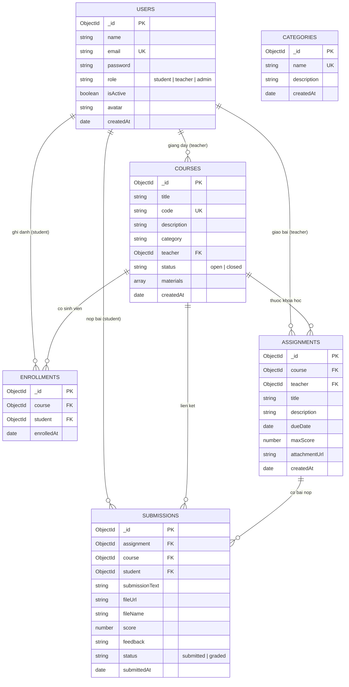

# 🎓 BÁO CÁO TIỂU LUẬN CUỐI KỲ
## 💻 MÔN HỌC: LẬP TRÌNH WEB (MERN STACK)

<div align="center">


---

### 🏛️ THÔNG TIN TRANG BÌA ĐỒ ÁN

| Thông tin | Nội dung chi tiết |
| :--- | :--- |
| **Tên đề tài:** | **XÂY DỰNG HỆ THỐNG LỚP HỌC TRỰC TUYẾN (ONLINE CLASSROOM)** |
| **Công nghệ áp dụng:** | **MERN Stack** (MongoDB, Express.js, React.js, Node.js) |
| **Họ và tên sinh viên:** | **Nguyễn Ngọc Mai** |
| **Mã số sinh viên (MSSV):** | **1822040747** |
| **Ngành đào tạo:** | Công nghệ Thông tin |
| **Cơ sở đào tạo:** | Trường Đại học Công nghệ Đồng Nai |
| **Giảng viên hướng dẫn:** | [Tên Giảng viên phụ trách môn học] |
| **Học kỳ / Năm học:** | 2026 - 2027 |

---

</div>

## MỤC LỤC
1. [Giới thiệu tổng quan về ứng dụng](#1-giới-thiệu-tổng-quan-về-ứng-dụng)
2. [Chi tiết các tính năng đã hoàn thiện](#2-chi-tiết-các-tính-năng-đã-hoàn-thiện)
3. [Thiết kế Cơ sở Dữ liệu (Database Design & ERD)](#3-thiết-kế-cơ-sở-dữ-liệu-database-design--erd)
4. [Tài liệu API (API Documentation)](#4-tài-liệu-api-api-documentation)
5. [Hướng dẫn cài đặt và khởi chạy dự án cục bộ](#5-hướng-dẫn-cài-đặt-và-khởi-chạy-dự-án-cục-bộ)
6. [Mô tả và Hình ảnh minh họa các màn hình chức năng](#6-mô-tả-và-hình-ảnh-minh-họa-các-màn-hình-chức-năng)
7. [Kết luận và Hướng phát triển](#7-kết-luận-và-hướng-phát-triển)

---

## 1. Giới thiệu tổng quan về ứng dụng

### 1.1. Lý do chọn đề tài
Trong thời đại chuyển đổi số giáo dục, các mô hình học tập trực tuyến (E-Learning / Online Classroom) ngày càng đóng vai trò quan trọng, kết nối linh hoạt giữa giảng viên và sinh viên, khắc phục rào cản về thời gian và khoảng cách địa lý.  
Dựa trên gợi ý đề tài tiểu luận MERN Stack, dự án **"Hệ thống Lớp học Trực tuyến (Online Classroom)"** được xây dựng nhằm cung cấp một giải pháp quản lý giảng dạy, học tập tập trung, hiện đại và bảo mật.

### 1.2. Mục tiêu của hệ thống
- Xây dựng hệ thống hoàn chỉnh theo mô hình **MERN Stack** (MongoDB - Express.js - React.js - Node.js).
- Phân định rõ ràng 3 nhóm người dùng: **Quản trị viên (Admin)**, **Giảng viên (Teacher)** và **Sinh viên (Student)**.
- Quản lý khóa học, bài giảng đa phương tiện (Văn bản đọc, Video, Tài liệu PDF tải về).
- Quy trình giao bài tập - nộp bài - chấm điểm và phản hồi khép kín, minh bạch.
- Đảm bảo an toàn thông tin với cơ chế mã hóa mật khẩu `bcryptjs` và xác thực phiên đăng nhập bằng `JSON Web Token (JWT)`.

---

## 2. Chi tiết các tính năng đã hoàn thiện

### 2.1. Xác thực và Phân quyền (Authentication & Authorization)
- **Đăng ký (Register):** Người dùng có thể đăng ký tài khoản với vai trò phù hợp (Sinh viên hoặc Giảng viên). Mật khẩu được mã hóa an toàn bằng thuật toán `bcrypt` trước khi lưu vào MongoDB.
- **Đăng nhập (Login):** Kiểm tra thông tin đăng nhập, xác thực trạng thái tài khoản (`isActive`). Nếu hợp lệ, hệ thống cấp phát mã `JWT Token` có thời hạn 30 ngày.
- **Phân quyền (RBAC - Role-Based Access Control):**
  - Tầng Backend sử dụng middleware `protect` và `authorize('admin', 'teacher', 'student')` để bảo vệ tài nguyên API.
  - Tầng Frontend sử dụng `ProtectedRoute` của React Router DOM để điều hướng, ngăn chặn truy cập trái phép vào các trang quản trị hoặc nghiệp vụ riêng.

### 2.2. Chức năng cho Giảng viên (Teacher)
- **Quản lý khóa học (CRUD Courses):** Giảng viên có quyền tạo lớp học mới, xem danh sách lớp học do mình phụ trách, chỉnh sửa thông tin hoặc xóa khóa học.
- **Đăng tải tài liệu học tập:** Hỗ trợ 3 định dạng tài liệu:
  1. *Bài đọc / Hướng dẫn lý thuyết (Text/Reading)*.
  2. *Liên kết Video bài giảng trực tuyến (YouTube, Video URLs)*.
  3. *Tệp tài liệu đính kèm (PDF, Word, Slide...)* thông qua module `multer`.
- **Quản lý bài tập (Assignments):** Tạo bài tập với tiêu đề, hướng dẫn chi tiết, hạn nộp (Deadline) và thang điểm tối đa (Max Score).
- **Theo dõi sinh viên & Chấm điểm:** Xem danh sách sinh viên đã ghi danh vào từng lớp học; xem danh sách bài nộp của sinh viên, tải file bài làm, nhập điểm số và viết nhận xét/góp ý.

### 2.3. Chức năng cho Sinh viên (Student)
- **Khám phá & Ghi danh (Browse & Enroll):** Xem danh sách tất cả các môn học đang mở trên hệ thống, tìm kiếm theo tên hoặc lọc theo danh mục chuyên ngành; thực hiện ghi danh chỉ với 1 click.
- **Học tập & Tải tài liệu:** Truy cập nội dung khóa học đã tham gia, đọc bài giảng, xem video hướng dẫn và tải các tài liệu PDF/tệp đính kèm về máy.
- **Nộp bài tập (Assignment Submission):** Điền văn bản bài làm hoặc tải tệp đính kèm (PDF, ZIP, Word...); có thể cập nhật lại bài nộp trước hạn.
- **Theo dõi kết quả học tập (Grades):** Xem bảng điểm tổng hợp của tất cả các bài tập đã nộp, trạng thái đã chấm/chưa chấm và nhận xét chi tiết từ giảng viên.

### 2.4. Chức năng cho Quản trị viên (Admin)
- **Dashboard Thống kê:** Theo dõi các chỉ số quan trọng trên toàn hệ thống (Tổng số người dùng, số lượng sinh viên, giảng viên, số lớp học đang mở, tổng lượt ghi danh).
- **Quản lý người dùng (Users Management):** Xem toàn bộ tài khoản, tìm kiếm, lọc theo vai trò; thực hiện **Khóa tài khoản (Lock)** đối với tài khoản vi phạm hoặc **Mở khóa (Unlock)** tài khoản; thay đổi vai trò (Role) người dùng.
- **Quản lý Danh mục (Categories Management):** Tạo mới, xem và xóa các chuyên ngành đào tạo (Công nghệ thông tin, Kinh tế, Ngoại ngữ...) để phân loại khóa học.

---

## 3. Thiết kế Cơ sở Dữ liệu (Database Design & ERD)

Hệ thống sử dụng cơ sở dữ liệu phi quan hệ **MongoDB** thông qua thư viện **Mongoose ODM**. Thiết kế bao gồm 6 collections chính:



### Chi tiết các Collection:
1. **Users:** Lưu trữ thông tin tài khoản người dùng, mật khẩu hash `bcrypt`, phân quyền `role` và cờ trạng thái `isActive` (dùng cho tính năng khóa tài khoản của Admin).
2. **Categories:** Lưu trữ các danh mục/chuyên ngành đào tạo do Admin quản lý.
3. **Courses:** Chứa thông tin môn học, mã khóa học `code`, liên kết giảng viên `teacher` (ObjectId ref Users) và mảng nhúng `materials` chứa các bài học (Text, Video Link, File PDF).
4. **Enrollments:** Bảng liên kết trung gian giữa sinh viên và khóa học đã đăng ký. Đảm bảo ràng buộc chỉ mục `compound index` `{ course: 1, student: 1 }` là duy nhất (tránh ghi danh trùng lặp).
5. **Assignments:** Lưu trữ các bài tập được giao trong một khóa học, bao gồm hạn nộp `dueDate` và thang điểm `maxScore`.
6. **Submissions:** Lưu trữ bài nộp của sinh viên cho bài tập tương ứng, file đính kèm, điểm số `score` và phản hồi nhận xét `feedback` của giảng viên.

---

## 4. Tài liệu API (API Documentation)

Hệ thống được thiết kế theo chuẩn **RESTful API**, trả về định dạng `JSON` và mã trạng thái HTTP chuẩn mực (200, 201, 400, 401, 403, 404, 500).

| Nhóm API | Phương thức | Endpoint | Phân quyền | Mô tả chức năng |
| :--- | :---: | :--- | :--- | :--- |
| **Auth** | `POST` | `/api/auth/register` | Public | Đăng ký tài khoản mới |
| | `POST` | `/api/auth/login` | Public | Đăng nhập hệ thống, nhận JWT Token |
| | `GET` | `/api/auth/me` | Authenticated | Lấy thông tin cá nhân hiện tại |
| **Users** | `GET` | `/api/users` | Admin | Lấy danh sách toàn bộ người dùng |
| | `GET` | `/api/users/stats` | Admin | Xem thống kê số liệu toàn hệ thống |
| | `PUT` | `/api/users/:id/toggle-status` | Admin | Khóa hoặc Mở khóa tài khoản |
| | `PUT` | `/api/users/:id/role` | Admin | Thay đổi vai trò (Student, Teacher, Admin) |
| **Courses**| `GET` | `/api/courses` | Public | Lấy danh sách khóa học đang mở (tìm kiếm, lọc) |
| | `GET` | `/api/courses/:id` | Public / Auth | Xem chi tiết thông tin, bài học của khóa học |
| | `POST` | `/api/courses` | Teacher / Admin | Tạo khóa học mới |
| | `PUT` | `/api/courses/:id` | Teacher / Admin | Cập nhật thông tin khóa học |
| | `DELETE` | `/api/courses/:id` | Teacher / Admin | Xóa khóa học |
| | `POST` | `/api/courses/:id/enroll` | Student | Ghi danh tham gia khóa học |
| | `GET` | `/api/courses/my-enrolled` | Student | Xem danh sách các lớp học đã ghi danh |
| | `GET` | `/api/courses/my-teaching` | Teacher / Admin | Xem danh sách các lớp học mình giảng dạy |
| | `POST` | `/api/courses/:id/materials` | Teacher / Admin | Đăng tải tài liệu học tập (PDF/Video/Đọc) |
| | `DELETE`| `/api/courses/:id/materials/:matId` | Teacher / Admin | Xóa tài liệu bài học |
| | `GET` | `/api/courses/:id/students` | Teacher / Admin | Xem danh sách sinh viên ghi danh trong lớp |
| **Categories**| `GET` | `/api/courses/categories` | Public | Lấy danh mục ngành học |
| | `POST` | `/api/courses/categories` | Admin | Tạo danh mục ngành học mới |
| | `DELETE`| `/api/courses/categories/:id` | Admin | Xóa danh mục ngành học |
| **Assignments**| `GET` | `/api/assignments/course/:courseId` | Authenticated | Lấy danh sách bài tập của khóa học |
| | `POST` | `/api/assignments/course/:courseId` | Teacher / Admin | Tạo bài tập mới cho khóa học |
| | `GET` | `/api/assignments/:id` | Authenticated | Xem chi tiết bài tập |
| | `DELETE`| `/api/assignments/:id` | Teacher / Admin | Xóa bài tập |
| | `POST` | `/api/assignments/:id/submit` | Student | Nộp bài tập (Upload file hoặc text) |
| | `GET` | `/api/assignments/:id/my-submission` | Student | Xem lại bài nộp và điểm số của mình |
| | `GET` | `/api/assignments/:id/submissions` | Teacher / Admin | Lấy danh sách bài nộp của cả lớp |
| **Grading** | `PUT` | `/api/submissions/:id/grade` | Teacher / Admin | Chấm điểm bài nộp & nhập lời phê |
| | `GET` | `/api/submissions/my-grades` | Student | Xem toàn bộ bảng điểm của sinh viên |

---

## 5. Hướng dẫn cài đặt và khởi chạy dự án cục bộ

### 5.1. Yêu cầu môi trường
1. **Node.js:** Phiên bản `>= 18.x` (khuyến nghị phiên bản 20.x hoặc 24.x).
2. **MongoDB:** MongoDB Server đang chạy cục bộ tại cổng mặc định `27017` hoặc chuỗi kết nối từ MongoDB Atlas.
3. **Trình duyệt web:** Google Chrome, Microsoft Edge, Firefox.

### 5.2. Các bước khởi chạy chi tiết

#### Bước 1: Khởi động Backend Server
```bash
# Di chuyển vào thư mục server
cd online-classroom/server

# Cài đặt các gói thư viện backend
npm install

# Khởi tạo dữ liệu mẫu kiểm thử (Users, Categories, Courses, Assignments demo)
npm run seed

# Chạy server ở chế độ phát triển
npm run dev
```
> Server sẽ khởi chạy thành công tại: `http://localhost:5000`  
> Khi chạy thành công, console sẽ hiển thị thông báo: `MongoDB Connected: 127.0.0.1`.

#### Bước 2: Khởi động Frontend Client
Mở một cửa sổ dòng lệnh Terminal mới:
```bash
# Di chuyển vào thư mục client
cd online-classroom/client

# Cài đặt các gói thư viện giao diện
npm install

# Khởi chạy ứng dụng React với Vite
npm run dev
```
> Trình duyệt mở tại: `http://localhost:5173`.

### 5.3. Tài khoản đăng nhập thử nghiệm (Test Accounts)
Tại màn hình Đăng nhập (`/login`), hệ thống hỗ trợ các nút **1-Click Quick Fill** tiện lợi:
- **Tài khoản Admin:** `admin@classroom.edu.vn` / `admin123`
- **Tài khoản Giảng viên:** `teacher@classroom.edu.vn` / `teacher123`
- **Tài khoản Sinh viên:** `student@classroom.edu.vn` / `student123`
- **Tài khoản Sinh viên bị khóa:** `tuan@classroom.edu.vn` / `student123` (dùng để kiểm thử chức năng chặn đăng nhập của Admin).

---

## 6. Mô tả và Hình ảnh minh họa các màn hình chức năng

### 6.1. Màn hình Đăng nhập & Đăng ký
- **Chức năng:** Cho phép người dùng đăng nhập bằng Email và Password; sinh viên/giảng viên mới có thể đăng ký tài khoản. Tích hợp sẵn nút điền nhanh tài khoản mẫu.
- **Điểm nổi bật:** Xác thực bảo mật, thông báo lỗi rõ ràng nếu sai mật khẩu hoặc tài khoản đã bị khóa bởi Admin.

### 6.2. Màn hình Dashboard (Trang tổng quan)
- **Chức năng:** Tùy biến thông minh theo từng vai trò:
  - *Admin:* Hiển thị 4 thẻ thống kê trực quan (Tổng người dùng, Tỉ lệ Sinh viên/Giảng viên, Số khóa học đang mở, Lượt ghi danh).
  - *Teacher:* Lối tắt vào quản lý các lớp học do mình phụ trách.
  - *Student:* Lối tắt vào lớp học đã tham gia và bảng điểm cá nhân.

### 6.3. Màn hình Khám phá Khóa học (Courses)
- **Chức năng:** Hiển thị danh sách khóa học đang mở dưới dạng lưới (Grid Cards). Hỗ trợ thanh tìm kiếm theo tên môn và bộ lọc theo danh mục (Pills). Sinh viên có thể nhấn nút **Ghi danh (Enroll)** ngay tại đây.

### 6.4. Màn hình Chi tiết Khóa học (Course Detail)
- **Chức năng:** Được tổ chức theo 3 Tabs nghiệp vụ:
  1. *Tài liệu bài học:* Xem bài đọc, mở video bài giảng, tải tài liệu PDF. Giảng viên có nút đăng tải tài liệu mới (hỗ trợ upload file).
  2. *Bài tập:* Danh sách bài tập, hạn nộp, thang điểm. Giảng viên có nút tạo bài tập mới.
  3. *Sinh viên ghi danh (Dành cho Giảng viên/Admin):* Bảng danh sách sinh viên đã tham gia lớp học.

### 6.5. Màn hình Bài tập & Chấm điểm (Assignment Detail)
- **Chức năng:**
  - *Đối với Sinh viên:* Xem đề bài và tệp đính kèm; điền nội dung giải trình và đính kèm file bài làm (ZIP/PDF/DOCX); sau khi giảng viên chấm, sinh viên xem được điểm số và lời phê chi tiết.
  - *Đối với Giảng viên:* Danh sách bài nộp của tất cả sinh viên; tải file bài làm; mở Modal chấm điểm (nhập điểm và nhận xét).

### 6.6. Màn hình Quản lý Người dùng (Dành cho Quản trị viên)
- **Chức năng:** Bảng danh sách toàn bộ người dùng trong hệ thống; hỗ trợ tìm kiếm; thay đổi vai trò (Student, Teacher, Admin); thao tác **Khóa / Mở khóa** tài khoản chỉ với 1 click.

### 6.7. Màn hình Quản lý Danh mục (Dành cho Quản trị viên)
- **Chức năng:** Thêm mới các chuyên ngành/danh mục khóa học (CNTT, Ngoại ngữ, Kinh tế...) và xóa danh mục khi cần thiết.

---

## 7. Kết luận và Hướng phát triển

### 7.1. Kết quả đạt được
- Hoàn thiện 100% các yêu cầu cốt lõi của đề tài tiểu luận cuối kỳ môn Lập trình Web theo chuẩn **MERN Stack**.
- Kiến trúc mã nguồn được phân tách module rõ ràng (MVC trên Backend, Component-based trên Frontend).
- Đảm bảo an toàn bảo mật dữ liệu người dùng (Mã hóa mật khẩu, JWT Token, Authorization).
- Giao diện thân thiện, hiện đại, responsive trên nhiều kích cỡ màn hình.

### 7.2. Hướng phát triển trong tương lai
- Tích hợp thêm tính năng thông báo theo thời gian thực (Real-time Notifications với Socket.io) khi giảng viên đăng bài tập mới hoặc chấm điểm.
- Hỗ trợ thi trắc nghiệm trực tuyến (Online Quiz) có tính năng tự động chấm điểm.
- Tích hợp phòng học trực tuyến qua video call (WebRTC / Zoom SDK).
